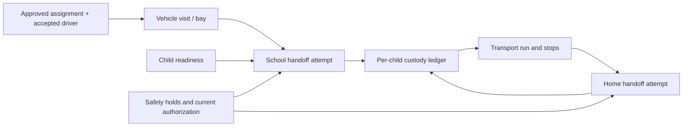

# Roles, journeys and custody state

This is the proposed behavioral contract. Implement authorization on the server; hiding a button is not a permission control. State names here are canonical for the initial build.

## Role and permission matrix

Scope is always a verified school membership, guardian-child relationship, assigned trip or assigned support case. An account can hold multiple roles; authority is evaluated for the selected action and resource, never the union of every school it can access.

| Action/data | Guardian | Assigned driver | Teacher | Gate staff | School admin | Platform safety/support |
| --- | --- | --- | --- | --- | --- | --- |
| Student information | Own authorized children | Minimum current manifest, after approval/acceptance | Assigned class/session | Assigned gate/session | Own school, duty-based | Case-limited; audited access |
| Approve driver/vehicle/destination | Own child, verified authority | No | No | No | Propose only | Propose only |
| Accept assignment | No | Own eligible assignment | No | No | No | No |
| Mark child ready / place readiness hold | View own | View own manifest | Assigned students | View; hold if unsafe | Own school | Safety hold only |
| Check in / call forward / assign bay | View own pickup | Request arrival | View class calls | Verify arrival, manage queue | Configure/resolve | Operational view by case |
| Record school handoff | View | Participate, cannot self-release | Only with explicit gate role | Execute verified transfer | Only with gate role | Reconcile exceptional evidence; cannot impersonate staff |
| Record home handoff | Receive if authorized recipient | Participate, cannot self-deliver | No | No | Completion/exception summary | Coordinate escalation/reconciliation |
| Live vehicle location | While own child is aboard; timestamped | Own active trip | No | Arrival/queue position only | Active transport exception access if assigned | Assigned active case |
| Other families' destinations/recipients | No | Required assigned stops only | No | No | Exceptional need only | Case need only |
| Eligibility documents | Public eligibility summary only | Own submissions/results | No | Validity summary | School acceptance status | Enrollment reviewer only |
| Reviews/incidents | Submit own completed-trip review/report | Own review and appeal information | Report concerns | Report concerns | Own school reports | Restricted case handling; separate safety decision role |
| Suspend/reinstate | Revoke own approval | Decline/cancel pre-custody | Request hold | Immediate school hold | School rejection/hold | Safety officer can suspend; reinstatement review |
| Export/audit | Own redacted history | Own redacted history | Limited class operation | Current session history | School-scoped report | Approved purpose, logged, redacted |

Home recipients use a verified, time-limited trip/child-scoped flow. They see the children they are authorized to receive and that handoff, not the household's full account. Ordinary support cannot alter driver eligibility, guardian authority or audit history. Elevated safety access requires a reason and recorded case; no universal “admin override release.”

## Journeys

**Guardian:** verify identity and relationship through the school's established authority process; choose an eligible, school-accepted driver; inspect vehicle, scheduled window, destination and receiving adults; approve the exact child/trip revision; see driver acceptance; receive readiness/release alerts; view fresh location only while their child is aboard; participate in or monitor home receipt; review the completed ride or report an incident. A guardian can revoke before release or request intervention while in transit. Custody disputes place the child on school hold pending authorized resolution.

**Driver:** submit enrollment evidence; receive reviewed eligibility and school acceptance; accept a feasible approved assignment; confirm vehicle/restraints and mobile readiness while parked; start the scheduled approach; check in; wait for a bay call; verify each child with gate staff; record boarding participation; depart only with resolved manifest; navigate without interactive tasks while moving; verify the receiving adult for each child; finish only after custody is resolved and perform an empty-vehicle check. Driver taps cannot override a hold.

**Teacher and gate:** teacher confirms students are present and ready, and responds to call-forward within supervised space. Gate verifies the arrived vehicle and driver, assigns a safe bay, checks each child and current permission, conducts handoff and clears the bay. A sibling still in class does not disappear from the manifest when another sibling boards. Exceptions move to supervised handling off the main line when physically safe.

**School administrator:** configure session hours, lanes/bays, staff duties, roster and verified guardians; accept drivers under school rules; reconcile the dated schedule; supervise no-shows, disputed permissions and traffic; finish the session only with every expected child accounted for. Readiness is not proof of attendance unless staff explicitly confirmed presence.

**Safety/support:** review onboarding; monitor active exception work with an assigned owner; contact adults through approved operational channels; preserve evidence; impose protective restrictions; record decisions and appeals; reconcile uncertain custody with school/driver/recipient evidence. Emergency response runs through the locally approved procedure, not an unmonitored in-app report queue.

## Independent but related state models

Use one pickup per child per dismissal session, one vehicle visit per school call-in, one trip per accepted run, and one trip passenger per child. Custody is per child. Trip status never implies that all children have the same custody holder.

### Assignment and permission

`draft → awaiting_approval → approved → accepted`; `declined`, `expired`, `revoked` and `superseded` are terminal for that revision. Parent approval and driver acceptance are separate records even if the UI presents a combined status. A replacement creates a new revision, not an edit to historical consent. Cancellation is only a pre-custody outcome; after custody begins, requests open an intervention case.

Every school transfer checks five distinct conditions: platform eligibility, school acceptance, verified guardian authority, current trip-specific approval, and driver acceptance. It also checks student presence/readiness, live safety holds, correct vehicle/restraints/capacity, service window and staff scope. Expired credentials fail at use time even if a reminder job did not run.

### Child pickup

| Transition | Actor and preconditions | Event/effect |
| --- | --- | --- |
| `expected → ready` | Assigned teacher confirms child present and prepared | `StudentReady`; custody stays school |
| `ready → expected` | Teacher/gate retracts readiness with reason before handoff | `ReadinessWithdrawn`; invalidate pending preparation |
| `expected/ready → held` | Teacher, gate, admin or safety; named reason and owner | `PickupHeld`; child remains supervised |
| `held → expected` | Authorized owner resolves cause; recheck readiness separately | `PickupHoldResolved` |
| `ready → release_pending` | Gate prepares transfer; five checks above; verified visit at bay; driver participates | `SchoolTransferPrepared`; reserve this child against competing release |
| `release_pending → released` | Both participants' evidence complete; server finalizes one handoff | `SchoolHandoffRecorded`; passenger becomes onboard |
| `release_pending → ready/held` | Gate aborts and explicitly verifies child remains at school | `SchoolTransferAborted`; never reset on timeout alone |
| `expected/ready/held → not_riding` | Staff confirms child absent or alternative supervised disposition; guardian request alone cannot prove location | `PickupDispositionRecorded` with reason; no transport custody event |

After `released`, return to school is a new custody transfer, not an undo. A verified return can produce a new recovery pickup attempt under the same session; original events remain. A transport cancellation must specify how the child still at school will be supervised and collected.

`not_riding` describes transport participation, not custody. If a guardian later collects that child directly, record the separate school-to-guardian transfer through the school's verified procedure and link its evidence. Do not use a cancellation or `not_riding` flag as proof that someone received the child.

### Vehicle visit and queue

`scheduled → checked_in → waiting → called_to_bay → at_bay → cleared`. Driver requests check-in; gate confirms physical arrival. GPS can suggest arrival but cannot claim a bay. Gate calls a waiting visit only when capacity exists and the intended children are ready. Bay occupancy uses a unique active allocation; command concurrency cannot allocate it twice.

From waiting/called/at-bay, gate can move a visit to `exception` with a safe physical instruction and reason, then back to waiting. `cancelled` or `no_show` requires no child aboard, confirmed by staff. Clearing a bay records vehicle departure from that bay, not completion of its trip. A no-show deadline creates an alert; staff confirm the disposition. Do not mark an entire family released with a single vehicle tap.

FIFO among eligible visits is the default; readiness, accessibility and safety can justify documented exceptions. No speed-based priority, countdown pressure, or incentives to arrive before supervised hours. A manual traffic marshal remains in control of physical movement.

### Trip and passenger

| Trip transition | Actor/check | Result |
| --- | --- | --- |
| `planned → accepted` | Driver accepts current approved assignment; capacity/schedule valid | Run reserved; no custody yet |
| `accepted → approaching` | Driver parked, starts trip-scoped location within service window | Approach tracking available to operations |
| `approaching → boarding` | Verified visit at bay | Child transfers may begin |
| `boarding → in_transit` | Driver departure confirmation; every manifest child either onboard or explicitly removed with supervised disposition; no open transfer | `TripDeparted`; skipped passenger cannot silently become delivered |
| `in_transit → at_stop` | Driver parked at intended stop | Arrival is informational; children remain with driver |
| `at_stop → in_transit` | Stop resolved and more stops remain | Continue only with explicit manifest and safe plan |
| `at_stop → completed` | Every passenger custody resolved, no pending handoff, final vehicle check | `TripCompleted`; stop tracking |
| `planned/accepted/approaching/boarding → cancelled` | No child transferred or onboard and every pending transfer resolved | `TripCancelled`; school remains responsible for unreleased children |
| Active state → `recovery` | Safety/support or verified exception after custody started | Assigned intervention plan and continuing custody accounting |
| `recovery → in_transit/at_stop/completed` | Safety owner validates safe continuation or verified alternate handoffs | Record disposition; completion tagged `recovered`, not normal delivery |

Passenger states: `scheduled → onboard → delivered`, or `scheduled → not_riding`; an onboard child may instead become `returned_to_school` or `transferred_to_authorized_alternate` after a new verified handoff. Emergency responder custody is a separate documented recovery disposition. Never force these into `delivered_home`.

Safety holds are independent records attached to driver, school, trip, passenger or recipient. Tracking health is `fresh / delayed / unavailable / stopped`. Neither is a replacement trip status. A suspended driver already carrying children remains the recorded holder until a verified safe transfer.

## Custody evidence and physical protocol

Custody records have `last_confirmed_holder`, `pending_transfer_id`, and `certainty = confirmed | transfer_pending | disputed`. A pending transfer does not assert that the child is physically still with the old holder. Each transfer records child, from/to adults or supervised institution, trip and assignment revision, method, witnesses, server times, reported physical time, policy versions and evidence references.

| Transfer lifecycle | Actor/check | Audit and projection |
| --- | --- | --- |
| No open attempt → `prepared` | Gate at school, or parked driver at home; current authority and verified intended recipient; reserve child | `SchoolTransferPrepared` or `HomeTransferPrepared`; certainty becomes transfer_pending |
| `prepared → confirmed` | Gate finalizes school evidence; driver finalizes home evidence only after authenticated recipient acknowledgement; both parties' observations required | `SchoolHandoffRecorded` or `HomeHandoffRecorded`; update last confirmed holder and passenger state atomically |
| `prepared → aborted` | Transfer initiator verifies no physical transfer occurred, with reason; safety reviewer if disputed | `TransferAborted`; retain old confirmed holder; release reservation only after check |
| `prepared → disputed` | Conflicting evidence, uncertain physical outcome, expiry/error after possible transfer; any participant can flag | `CustodyDisputed`; retain reservation and last confirmed holder labeled uncertain; no new release |
| `disputed → confirmed/aborted` | Two authorized reviewers reconcile physical facts and evidence; no ordinary participant override | `CustodyReconciled` plus confirmed handoff or abort event; original attempt/evidence retained |

Evidence acknowledgements are separate authenticated commands tied to the same attempt and revision. A participant cannot submit the other party's acknowledgement. A guardian already named as the home recipient acts in that recipient scope; a remote guardian is not a substitute physical witness.

**School:** gate sees child identifier and identification aid, current driver photo/name and vehicle plate; staff physically match all three. Driver authenticates and presents a short-lived trip-bound challenge; gate scans and checks current authority. Preparation reserves the child and binds driver participation. Gate witnesses boarding and records completion; driver's boarding acknowledgement completes the paired evidence. Only the final server transaction marks `released/onboard`. Keep the vehicle at the bay until confirmation or supervised reconciliation. Codes are single-use, expiry-limited, rate-limited and stored hashed; possessing one is insufficient without authenticated roles and physical matching.

**Home:** driver arrives and parks; authenticated authorized recipient uses a scoped link/account to confirm identity and the specific children, with a one-time challenge separate from any driver credential. Driver checks the person against the approved recipient record and records the physical exchange; recipient acknowledges receipt. Both are required for normal completion. A remote parent's approval or relayed code alone does not prove the named adult is physically there. No routine photo/video of children or identity-document scan is required as handoff evidence.

Preparation and finalization have short policy-configured validity windows. Recheck authorization at both. Physical actions and a database transaction cannot be truly atomic: revocation, lost connectivity or a mistaken tap can happen during boarding. If expiry/revocation/error occurs after possible physical transfer, retain the pending record, block any second release, set disputed custody and require immediate staff/support reconciliation. Never automatically put the child back in a releasable school state. UI must say “Transfer needs confirmation,” not “Safe at school.” This residual human risk requires supervised practice, not more optimistic software.

## Exception behavior

| Situation | Required response |
| --- | --- |
| Permission revoked before transfer | Serialize revocation with handoff; invalidate approval/challenge, place hold, notify gate and driver; guardian gets effective result |
| Revocation during possible transfer | Block further transfer commands; show uncertain custody; contact participants and reconcile physical holder |
| Revocation after recorded school release | Open urgent intervention; do not erase custody or simply cancel. Keep the driver accountable and preserve minimum active-trip communications until safe resolution |
| Driver or vehicle substitution | New eligibility/acceptance checks, new assignment revision, fresh guardian approval for every affected child; no automatic substitution |
| One sibling unready | Wait in approved exception area, or explicitly amend manifest with guardian approval and school-supervised disposition; record each child separately |
| Parent/driver no-show or cancellation | Child stays supervised at school; alert owner; agree new authorized plan before changing custody |
| Recipient absent, identity mismatch or invalid challenge | No delivery completion; child stays supervised with driver at a safe location; support contacts approved backup adult and confirms lawful plan; no unattended curb/door drop |
| Guardian unreachable | Use pre-agreed school/operator escalation and approved backup recipient rules; return only to a confirmed open, staffed receiving location; emergency pathway if needed |
| Tracking lost | Mark stale and escalate by policy; do not fabricate route, handoff or incident severity; driver acts only when safe to stop |
| Crash, medical issue, threatened child or missing child | Follow local emergency protocol immediately, then notify support/school/guardian as appropriate; preserve actual custody and evidence |
| Reported handoff contradicts records | Open disputed-custody case; freeze new releases; two-person reconciliation appends correction with evidence; original events remain |

## Synchronization and outage contract

Each command returns the committed resource versions and event IDs. Each screen displays server status, last successful refresh and tracking sample time separately. Pending local intent is visually distinct from committed action. No optimistic release/delivery display. Push alerts invite a fresh read; they are not authorization or proof.

An uncertain mutation response triggers lookup by its idempotency key. If committed, show that outcome. If absent, refresh and revalidate before an explicit resubmission using the same key; no blind offline replay of custody commands. Conflicting versions return `409` and current authorized state. Duplicate/out-of-order events never rewind the view.

On reconnect, reauthenticate, fetch current authorized snapshot with versions, subscribe, then refetch to cover the subscription race; use periodic snapshot reconciliation because messages can be missed. Cancel subscriptions and clear local private state on logout/account change. Server checks current relationships on every sensitive read regardless of a still-valid identity token.

**At school outage:** freeze new PICK releases; children remain supervised. School may use its separately approved manual dismissal procedure with current authority verified through its designated office, two-person logging and explicit manual-control ownership for the session. Cached app permission is never sufficient. Quarantine all affected pickups from digital release until manual records reconcile.

**In transit outage:** maintain supervision, use the approved phone/radio escalation path when safely parked, and coordinate verified recipient/backup handoff through the designated dispatcher. If no trusted verification path exists, do not leave the child; follow the staffed contingency plan. Later record `manual_observation` with reported time, recording time, witnesses and source, not a backdated ordinary API success. Manual custody can be physically complete while digital custody remains pending; make that distinction visible. Test outage entry, shift ownership and reconciliation before real rides.
