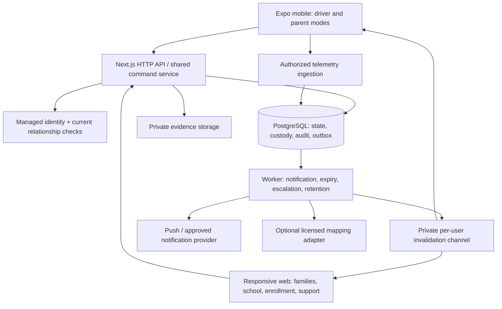

# Architecture and data contract

Proposed choice D05: TypeScript, Expo/React Native mobile, Next.js responsive web and API, and Supabase-managed PostgreSQL/Auth/Storage with restricted Realtime. This retains the earlier candidate after evaluating alternatives; it is not an already-approved user decision. Keep a modular monolith and one authoritative database for the pilot.

## Stack comparison

| Dimension | Proposed: Expo + Next.js + Supabase/PostgreSQL | Credible alternative: Expo + React web + Firebase Auth/Firestore + server functions |
| --- | --- | --- |
| Custody invariants | Relational keys, unique constraints and transactions fit child/guardian/trip/authority relationships | Atomic document transactions are possible; design guard documents and duplicated relationship views carefully |
| Concurrency | Lock common authority and custody rows; reject stale versions | Transaction retries are supported; callbacks must tolerate reruns |
| Authorization | Central command/read layer plus database grants/RLS and private storage | Central command/read layer plus Firestore rules; server SDK paths need their own authorization |
| Offline experience | Explicit cached read state and reconciliation | Client offline capabilities are useful for drafts; never allow a queued write to authorize custody |
| Reporting | SQL joins support school, vehicle, handoff and incident denominators | More denormalization or analytical export is likely for this domain |
| Team cost | SQL policy/transaction expertise plus mobile TypeScript | Familiarity may favor Firebase; duplicated projections/rules add maintenance |
| Lock-in | Managed auth/realtime integration remains vendor-specific; relational data can migrate | Documents, rules, triggers and listeners become more coupled to Firebase |
| Operating load | Managed persistence/auth, a web/API runtime and one worker | Managed persistence/auth and server-function operations |

The comparison is engineering judgment for PICK, not a universal performance ranking. Firestore supports atomic transactions and reruns them on relevant concurrent edits; client transactions fail offline. That does not make it unsuitable, but it does not solve disconnected custody. [Firebase transactions](https://firebase.google.com/docs/firestore/manage-data/transactions).

Choose PostgreSQL because consistency across authority, manifest, capacity and custody is central here. Reconsider Firebase if the actual team has substantial experience with it and can demonstrate the same negative-access and concurrency tests. A fully custom PostgreSQL/API/auth stack is another exit path, but owning more infrastructure has no demonstrated pilot benefit. Do not choose a provider on an unverified free-tier or monthly-cost claim.

## Runtime boundaries



One mobile codebase can provide parent and driver modes with distinct navigation and permissions. Only driver mode requests background location, and only for active assigned service. Parent approval, receipt and history also work in responsive web on iPhone/Android/desktop. Teachers and gate staff use tablet/phone-friendly web; school administration and safety review target desktop. Driver desktop access supports application documents, schedule review and history, not active tracking. Shared schemas and API clients do not imply shared DOM/native components.

Expo documents background tracking constraints, terminated-app behavior and the need for a development build for background location. Physical iOS/Android tests are a release gate; a browser or JavaScript bundle is insufficient evidence. Pin SDK-compatible versions when implementation starts rather than naming an untested version here. [Expo Location](https://docs.expo.dev/versions/latest/sdk/location/).

Suggested future repository layout (not created as application code):

```text
apps/mobile/                 Expo Router app and native adapters
apps/web/                    Next.js pages and /api/v1 transport adapters
apps/worker/                 Outbox, expiry, escalation and retention jobs
packages/contracts/         Versioned schemas, error codes and generated clients
packages/domain/            Server command orchestration and policy definitions
packages/test-fixtures/     Synthetic schools, users, vehicles and location traces
supabase/migrations/        Schema, constraints, grants, RLS, command functions
supabase/tests/             Database authorization and concurrency assertions
docs/                       Product decisions and runbooks
```

Use a persistent worker runtime for jobs; do not rely on a browser, a request remaining alive or a push provider to execute time-critical work. Host choice, regions, backup capabilities and prices need validation before purchasing. Separate development, synthetic staging and eventual production accounts/data. No real child data in developer fixtures or preview deployments.

## Data model

UUID identifiers, server `timestamptz` for recorded times, explicit school IANA time zone and service date, integer `version` on mutable aggregates. Store reported device/physical timestamps separately. School-scoped tables carry `school_id`; composite foreign keys bind children, pickups, trips and sessions to the same school. Global identity or driver records do not grant cross-school authority.

| Entity | Essential fields / relations | Invariant or access boundary |
| --- | --- | --- |
| `school`, `dismissal_session`, `bay` | Time zone, supervised window, staff assignments, bay capacity | Session local date unambiguous; one active bay allocation |
| `user_profile`, `school_membership` | Auth subject, role, school, active interval, authorization epoch | Role is server-managed; teachers scoped to class/session |
| `student`, `enrollment` | School student ID, display identity, identification aid, required assistance/restraint profile | No public lookup; sensitive operational assistance separated from general roster |
| `guardian_relationship` | Adult, child, authority scope, verified-by/evidence, validity, disputed flag, epoch | Sign-up or a matching surname cannot establish guardian authority |
| `driver_profile`, `driver_eligibility` | Application status, eligibility decision, expiry, restrictions, epoch | Public summary excludes document numbers and allegations |
| `credential`, `vehicle`, `vehicle_eligibility` | Type, evidence reference, verifier, validity; vehicle/seat/restraint limits | Documents private; expired or unsuitable vehicle blocks new assignment/release |
| `school_driver_acceptance` | School, driver/vehicle or allowed scope, validity, policy version | Platform eligibility alone cannot bypass school rules |
| `policy_version`, `policy_acceptance` | Immutable policy text reference/hash, actor and accepted time | Record the policy actually agreed, not only latest version |
| `trip`, `trip_stop` | Driver/vehicle, service window, status, ordered destination refs, manifest version | One active trip per driver/vehicle; pilot one household stop |
| `trip_passenger` | Trip, child, pickup, destination, passenger state, restraint allocation | One active transport assignment per child/session; preserve superseded history |
| `assignment_revision`, `guardian_approval`, `driver_acceptance` | Exact payload hash/version, child, named driver/vehicle, recipients, validity and revocation time | Approval is per child; sibling relationship never implies authority |
| `recipient_authorization` | Child, trip revision, adult identity, validity, permitted backup role | Guardian authority checked when created and when used |
| `pickup`, `vehicle_visit`, `bay_allocation` | Child readiness, visit queue status, actual arrival/call/bay/exit times | Queue state separate from child state; unique active bay use |
| `custody_transfer`, `custody_current` | From/to holders, attempt state, evidence refs, version, certainty | At most one open transfer per child; one finalized outbound handoff per pickup attempt |
| `safety_hold`, `intervention_case` | Scope, reason category, owner, severity, state, resolution | Holds independently block unsafe actions; in-transit holder remains accountable |
| `handoff_challenge` | Hashed nonce, purpose, child/attempt, subject, expiry, consumed time | Single use; school and home purposes never interchangeable |
| `telemetry_session`, `location_sample` | Trip/driver/device lease, sequence, sample/receive times, coordinates, accuracy, speed/unit, source | Accept only active scoped sessions; unique device-session sequence; no off-trip tracking |
| `telemetry_candidate` | Sample refs, map version/source, limit, confidence, algorithm version, review state | Separate from substantiated incident and rating |
| `review`, `incident`, `case_evidence`, `appeal` | Completed passenger relationship; allegation/finding distinction; decision history | One review per guardian/eligible ride policy; restrictions need explicit decisions |
| `command_receipt`, `audit_event`, `outbox` | Idempotency key/hash, result refs; actor/versions; delivery attempts | State, evidence/event and outbox written in one transaction |
| `manual_reconciliation`, `access_log`, `retention_hold` | Source record, reported/recorded times, reviewers; purpose; lawful hold | Correct history by addition; sensitive reads/exports auditable |

Place destination coordinates/contact details, custody restrictions and eligibility evidence in restricted relations/storage rather than general realtime rows. A driver may span schools only through separate acceptance records and assignments. Two-school synthetic fixtures are required even for a one-school pilot.

Database constraints: foreign keys; checks for valid intervals/nonnegative capacity; unique active passenger per child/session; unique active transfer per child; unique bay allocation; unique command `(actor_id, idempotency_key)`; unique finalized transfer per pickup attempt. Reserve vehicle/driver scheduling and seat allocation inside transactions with shared scheduling locks; app-only capacity counting can race. Add exclusion constraints or equivalent lock-protected interval checks for overlapping scheduled assignments. Returning a child never deletes the outbound transfer.

Represent repeat/recovery school transfers with an explicit `pickup_attempt` child of the single session pickup. Uniqueness of a finalized outbound transfer is per attempt; the child-level open-transfer lock spans every attempt and trip. Audit/evidence references identify the attempt, so a new recovery attempt cannot conceal a previous departure.

## Authoritative command transaction

All sensitive mutations use named commands; clients never `UPDATE status` directly. The API validates identity, request shape and rate limits, then invokes a narrow database command function. Client roles cannot execute these functions or mutate custody tables. A restricted server command role has function execution access; function ownership, fixed search paths and grants are explicitly migrated. The API passes the verified actor ID, never a request body's claimed actor. Domain authorization is rechecked against current database records inside the transaction.

An example envelope:

```json
{
  "command": "FinalizeSchoolTransfer",
  "idempotencyKey": "client-generated-uuid",
  "pickupId": "opaque-uuid",
  "transferId": "opaque-uuid",
  "expectedVersions": { "pickup": 7, "transfer": 2, "assignment": 3 },
  "evidence": { "staffObservationId": "opaque-uuid", "driverAcknowledgementId": "opaque-uuid" }
}
```

Server transaction order:

1. Authenticate identity and current action scope. Reserve the idempotency receipt using a unique key and request hash. A reused key with different content returns `IDEMPOTENCY_MISMATCH`. Concurrent identical requests converge on one result.
2. Lock relevant authority/eligibility guard rows, then trip/visit/bay rows, then child custody/pickup rows, in a documented table and sorted-ID order. Revocation, suspension, manifest changes and release must acquire the same relevant guards. This avoids “check permission, then release after it was revoked.” Missing eligibility/relationship rows fail closed; creation and replacement use their parent guard.
3. Check expected versions, current policy/approval/expiry, active holds, participant scope, challenge validity, state and capacity. Server time is authoritative for expiry. A stale JWT role claim is insufficient.
4. Consume required challenges and persist paired evidence, child custody projection, pickup/passenger state, versions, audit events and notification outbox rows atomically. If any write fails, none commits.
5. Commit and return receipt/event IDs plus authorized state. External push, map calls or uploads never run inside the transaction. Upload evidence first to private staging; attach verified references on commit and clean orphans later.

PostgreSQL row locking supports this serialization, provided every conflicting writer participates; lock ordering and deadlock handling must be tested. [PostgreSQL explicit locking](https://www.postgresql.org/docs/current/explicit-locking.html). Retry only a known rolled-back database transaction with a bounded policy. A lost HTTP response requires receipt lookup, not an assumption about rollback.

Revocation concurrent with release has a defined order: if revocation commits first, release fails; if release commits first, revocation produces intervention and reports existing custody. A pending physical transfer invokes the uncertainty procedure in document 02. No client may decide which outcome occurred from its own clock.

Suggested endpoints: `GET /api/v1/pickups/:id`, `GET /api/v1/trips/:id` (role-filtered projections), `POST /api/v1/commands`, `GET /api/v1/commands/:key`, `POST /api/v1/telemetry/batches`, and scoped case/evidence endpoints. Use `401` for missing identity, non-enumerating `404` for inaccessible resources, `409` for version/state conflicts and typed `422` reasons such as `AUTHORIZATION_REVOKED`, `ELIGIBILITY_EXPIRED` or `RECIPIENT_UNVERIFIED`. All endpoints cap body sizes and validate foreign-resource references.

Receipt lookup and duplicate-result replay also recheck current read scope. Store result references and versions rather than replaying a historical sensitive response after access was revoked. Internal deduplication still prevents another execution even when the caller can no longer read the original resource. Retain minimal idempotency records for at least the full action/replay lifecycle; deletion must not reopen a finalized custody transition.

## Read authorization and realtime

All sensitive reads go through the API with current relationship/assignment checks and field-level projections. Native uses bearer identity; web uses secure HttpOnly session cookies and CSRF protection on mutations. Verify token issuer/audience/expiry and current account status; keep server secrets off clients. Privileged school/safety roles require stronger authentication and reauthentication for authority changes. Next.js recommends authorization near data access, including server mutations; route/layout visibility is insufficient. [Next.js authentication guidance](https://nextjs.org/docs/app/guides/authentication).

Use RLS and least-privilege grants as defense in depth on any exposed table/storage path. Private schemas protect the custody and evidence tables. Audit views, function ownership and administrative credentials explicitly: Supabase documents that elevated keys can bypass RLS and views can expose underlying rows. [Supabase RLS](https://supabase.com/docs/guides/database/postgres/row-level-security).

Do not broadcast child names, destinations, coordinates or full status records over shared school/trip channels. Send only a generic `refresh_required` hint to a private channel per authenticated user; the worker determines eligible recipients from current relationships at send time. Sensitive content is fetched through authorized reads. Deny client broadcasts. Supabase documents cached channel permissions that can outlive membership revocation until refresh/expiry; changing an RLS membership is therefore not an immediate channel cutoff. [Realtime authorization](https://supabase.com/docs/guides/realtime/authorization).

Keep JWT/channel lifetimes bounded and force session renewal on access changes, but do not rely on a cooperative client disconnect. No raw data on those channels means a retained connection cannot keep reading the old trip. At most a racing generic hint may arrive. Read endpoints deny immediately after committed revocation, apart from requests already authorized in flight; previously downloaded data cannot be recalled. For the pilot, authorized polling can deliver correct state while realtime is temporarily unavailable.

Driver suspension removes new-work and unrelated-child access. If the driver is the recorded or possible current holder, a separate, explicitly audited recovery scope can retain only the active manifest and dispatcher-approved next handoff needed to resolve custody. End that scope at verified transfer. It must not restore normal eligibility or permit new pickups. A compromised account instead requires trusted out-of-band coordination; do not keep a compromised login authorized merely because a trip is active. Legal basis for necessary ongoing tracking after a consent change must be settled in the operating/privacy review.

Snapshots carry resource versions, server time and a scoped audit cursor where needed. Treat event IDs as opaque: a database sequence alone is not proof of global commit ordering. Reconcile from current snapshots on reconnect and periodically; audit pagination needs a stable server implementation with overlap/deduplication. Avoid a fragile “largest sequence seen means everything earlier arrived” recovery scheme.

## Audit, reliability and storage

Append domain audit events with actor, effective role, school, resource IDs, command/correlation ID, previous/new versions, evidence/policy references and recorded time. Deny update/delete to application roles; record corrections as new linked events. This is application-level immutability, not immunity to a database administrator. Before live pilot, export signed daily digests/events to separately controlled retention storage and verify restoration/integrity. Chain/hash anchors must live outside the same writable database to offer meaningful tamper evidence. Do not put raw identity documents, codes or detailed GPS in general audit payloads.

Outbox delivery is at least once; workers and notification consumers deduplicate event IDs. A notification failure cannot undo a handoff. Monitor outbox age, command failures, unacknowledged critical cases, open transfer attempts, backup age and telemetry freshness. Design restore procedures to freeze new releases and reconcile any custody events potentially lost after the recovery point before reopening operations; a restored database is not automatically current physical truth.

Native stores small session credentials using secure platform storage; it must not fall back to plaintext if that fails. [Expo SecureStore](https://docs.expo.dev/versions/latest/sdk/securestore/). Keep a minimal encrypted active-trip cache for the operating contingency, bounded by session and retention policy, with logout/device-loss clearing where possible. Web responses containing personal data use private/no-store behavior and avoid service-worker caching of sensitive API responses. Log redaction applies to analytics, crash reports and request traces.

## Nonfunctional targets to decide by measurement

Use the provisional capacity in document 01 to test simultaneous arrivals and commands, then a synthetic burst above that cap to expose contention. Record API latency, connected-view convergence, queue usability and worker delay. Agree explicit service-level thresholds after this measurement and before the live gate; no reliability or latency result has been demonstrated yet. Load shedding may delay telemetry/analytics, but custody commands and emergency workflows need protected capacity. Cost estimation should count active-device sample rates, event fanout, data retention, map requests, notification traffic and staffed support separately.
